# FiscalHub user guide: for companies

FiscalHub sends your sales to ZIMRA and gives you back a **fiscal tax invoice** with its ZIMRA number and QR code. This guide walks you through every screen, in the order you will need them.

> **Tip:** the menu on the left is grouped into sections (Fiscalisation, Integration, Administration, Accounting). Click a section name to open it. What you see depends on your role and your plan.

## 1. Sign up and sign in

1. On the FiscalHub website, click **Get started** (or **Start free trial** on a plan).
2. Fill in your company name, TIN, your name, email, phone and a password, and choose a plan.
3. Enter the 6-digit code we email to you (and, if you gave a phone number, text to you). Your account opens at once.

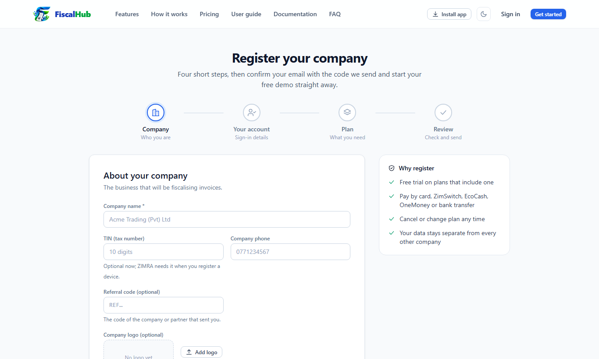
*Registering your company.*

To come back later, open the website and click **Sign in**. Use your email (or user name) and password. **Forgot your password?** Click the link on the sign-in page: we send a code by email and SMS.

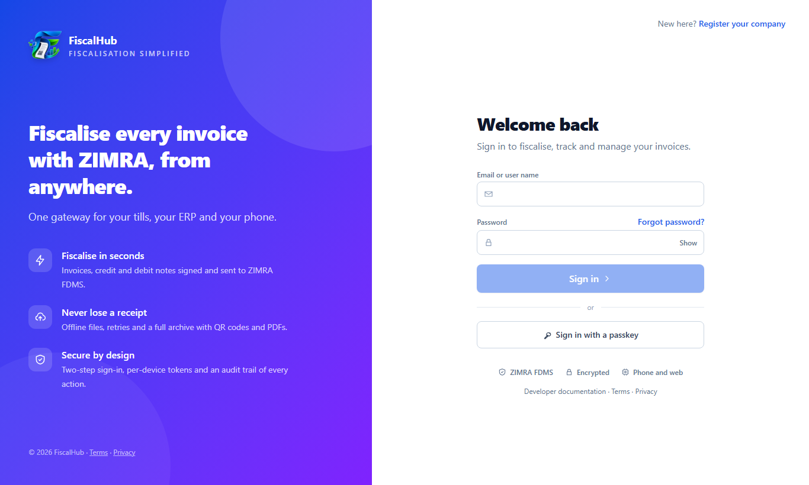
*The sign-in page.*

## 2. Your dashboard

After signing in you land on the **Dashboard**. It greets you, offers the most used buttons (**New invoice**, **Import**, **Fiscal day**) and a **Getting started** list that ticks itself off as you go.

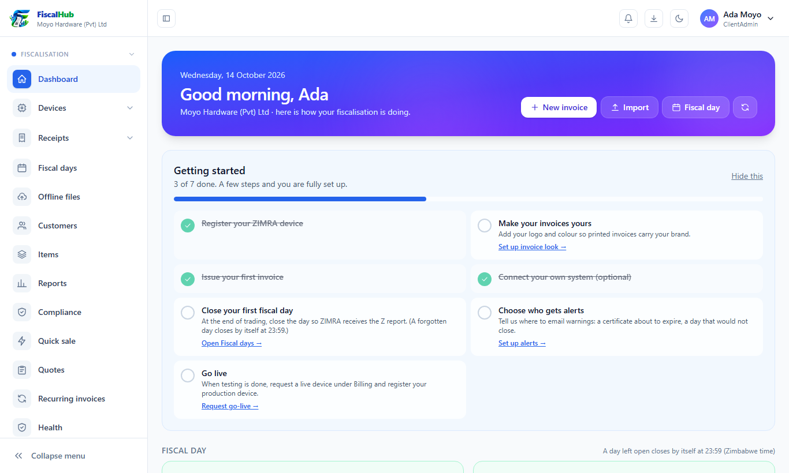
*The dashboard with the Getting started checklist.*

Further down you see today's fiscal day, your sales and anything that **needs your attention** (for example an invoice ZIMRA rejected, or a day that is close to its 24-hour limit).

## 3. Register your fiscal device

Every sale is fiscalised on a **fiscal device** that ZIMRA gave you (a device ID and an activation key).

1. Open **Fiscalisation → Devices → Register device**.
2. Type the **Device ID**, **Activation key** and **Device serial number** from ZIMRA.
3. Choose the **Environment**: *Test* while you try things out, *Production* for real invoices (see *Going live* below).
4. Check that **Model name** and **Model version** are exactly what ZIMRA registered.
5. Click **Check taxpayer** to see your details from ZIMRA, then **Register device**.

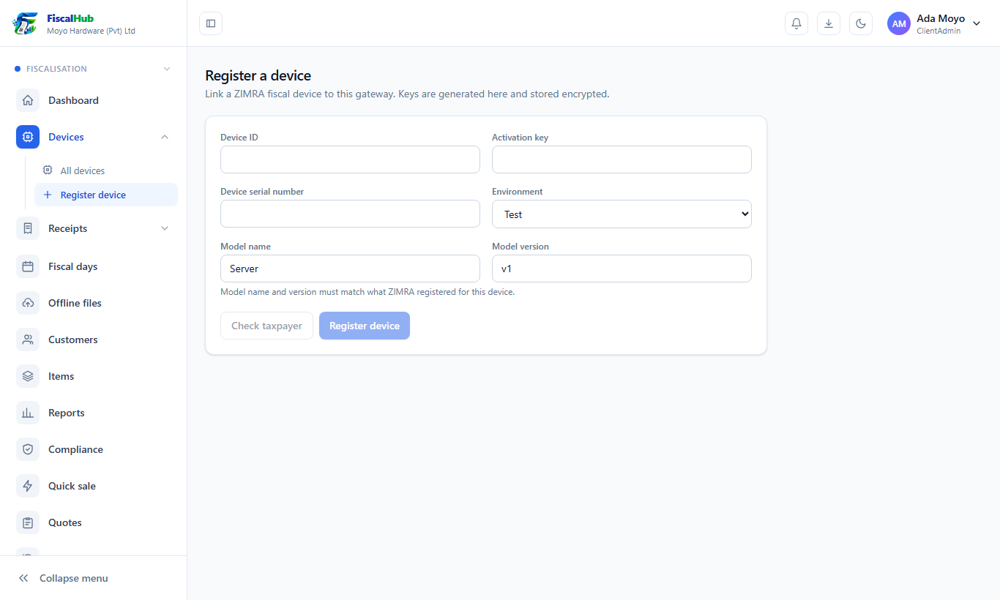
*The Register a device form.*

Your devices are listed under **Devices → All devices**, with their status, certificate expiry and taxes.

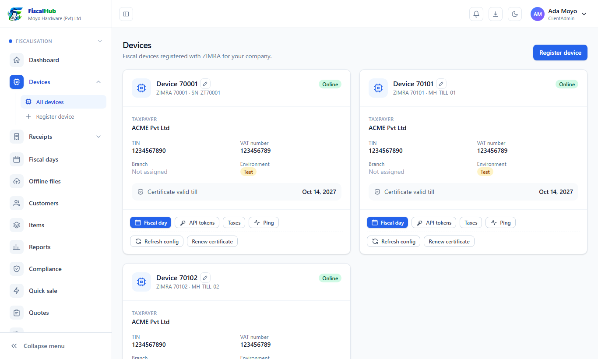
*All devices.*

## 4. Issue a fiscal invoice

1. Click **New invoice** (on the dashboard, or **Receipts → New invoice**).
2. Choose the **Device**, the **Type** (Invoice, Credit note or Debit note), the **Currency** and the **Payment method**, and type your **Invoice number**.
3. Pick a **customer from your register**, or type the buyer's name and TIN (optional for walk-in customers).
4. Add the lines: start typing an item name to pick it from your items, or type it in full. Every line needs an **HS code** (8 digits) when you are VAT-registered.
5. Read the yellow **Check before you send** box: it lists anything still missing.
6. Click **Issue to ZIMRA**. The invoice goes to ZIMRA and comes back with its fiscal number and QR code.

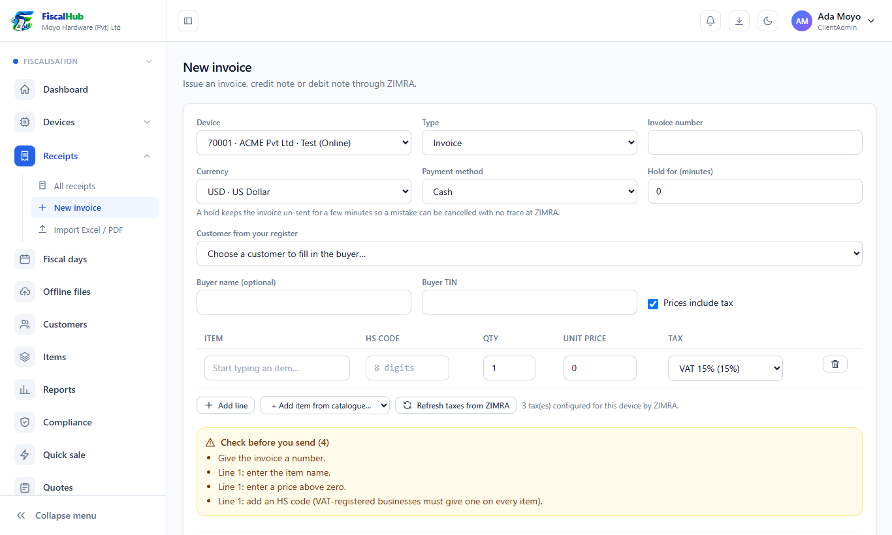
*The New invoice form. The yellow box lists what is still missing.*

> **Hold for (minutes):** keeps the invoice un-sent for a few minutes, so a mistake can be cancelled with no trace at ZIMRA. The button then reads **Hold & send later**.

## 5. Find, print and send invoices

**Receipts → All receipts** lists everything you issued, newest first. Filter by device, status, invoice number or dates. Each row has **View**, **Receipt PDF** (80 mm slip), **A4** and **Correct…**.

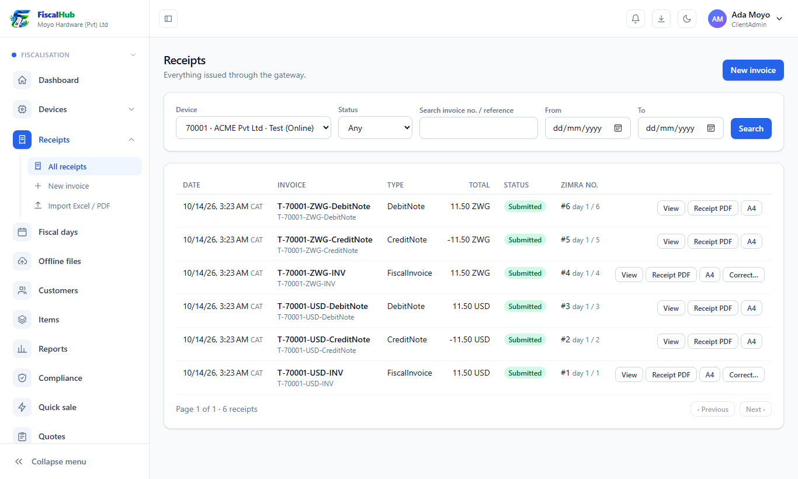
*All receipts with their ZIMRA numbers.*

Click **View** to see the invoice with its QR code:

- **Verify on ZIMRA** opens ZIMRA's own page, so you (or your customer) can check the invoice is registered.
- **Invoice PDF (A4)** and **Receipt PDF** download the printable invoice.
- **Send it to the customer:** **Email the invoice**, **SMS** (texts the invoice number, total and link), **WhatsApp**, or **Copy customer link**. The link opens a page with the invoice, its QR code and a PDF, with no sign-in, for 90 days.

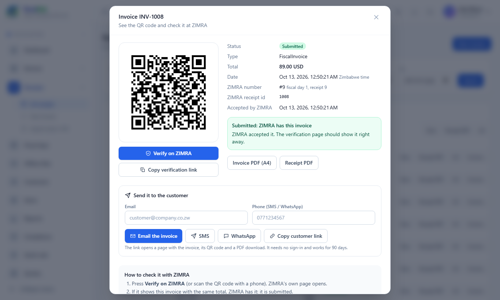
*An invoice: QR code, PDFs and Send it to the customer.*

## 6. Credit notes and corrections

A fiscal invoice can never be edited or deleted. To refund or fix one:

1. In **All receipts**, click **Correct…** on the invoice.
2. Give the **reason** (ZIMRA requires one).
3. To fix a wrong HS code, enter the right code for that line and tick **Also issue a corrected invoice with the same items and payment**.

FiscalHub issues a **credit note** that reverses the invoice and, if you asked, a corrected copy. If your company uses approvals, the credit note waits for approval first (see *Approvals*).

## 7. The fiscal day

ZIMRA works in **fiscal days**. The day opens by itself with your first sale. At the end of trading, close it so ZIMRA receives the **Z report**.

1. Open **Fiscalisation → Fiscal days** and choose the device.
2. Check the counters (what the Z report will contain).
3. Click **Close fiscal day**.

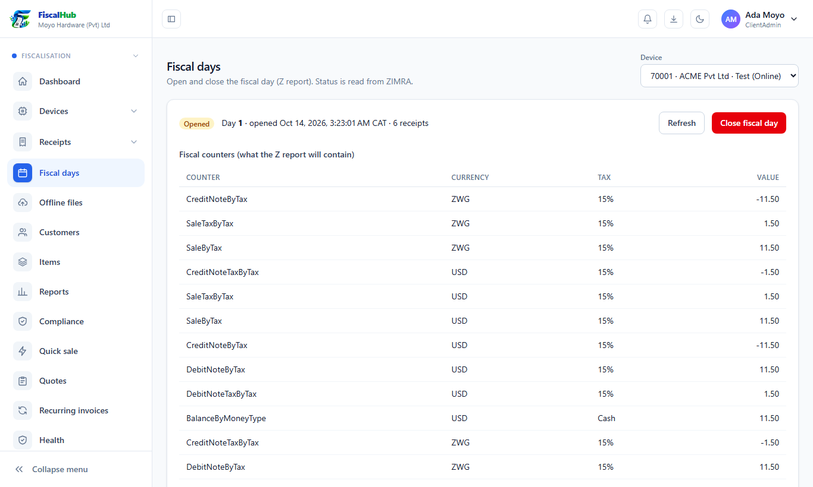
*An open fiscal day and its counters.*

> **Forgot to close?** FiscalHub closes any open day at **23:59** Zimbabwe time by itself. If ZIMRA refuses (for example a receipt was flagged red), you get an alert telling you what to fix.

## 8. Customers and items

Save the people you sell to and the things you sell, so invoices take seconds.

- **Customers:** name, TIN, VAT number, email and phone. The phone is used to send invoices by SMS or WhatsApp.
- **Items:** name, HS code, price and VAT. Items fill in the HS code and tax for you on every invoice.

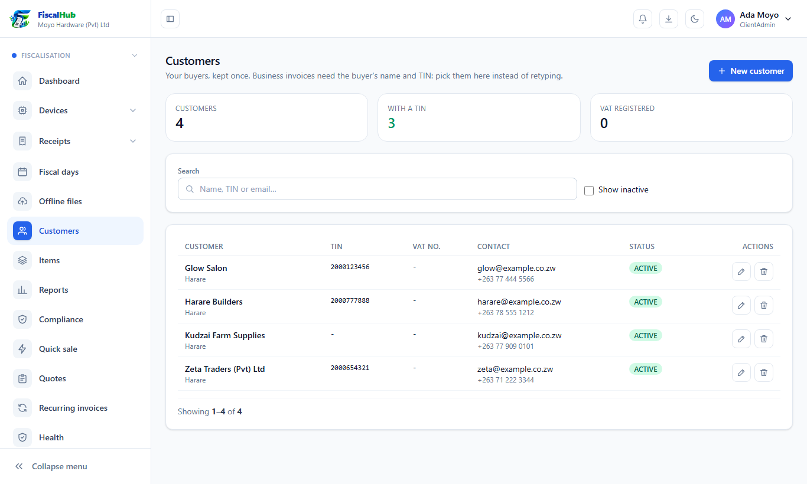
*Your customers.*

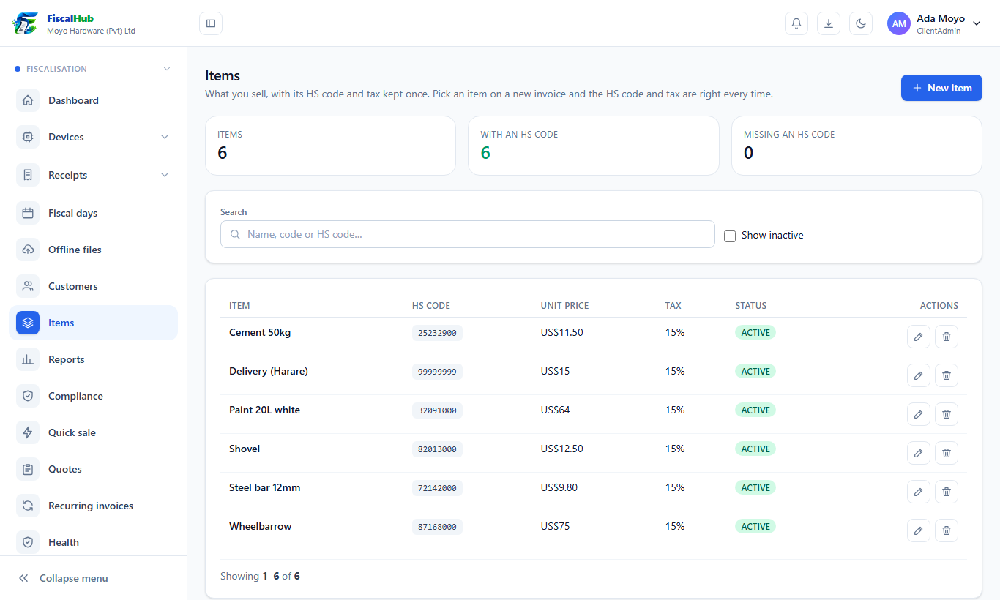
*Your items, with HS codes and prices.*

## 9. Quick sale, quotes and imports

- **Quick sale (POS):** a fast counter screen for walk-in customers: tap items, take the payment, issue the receipt.
- **Quotes:** send a quote; when the customer accepts, turn it into a fiscal invoice in one click. **Recurring invoices** issue the same invoice on a schedule.
- **Import Excel / PDF:** upload a spreadsheet or the PDF invoices your own system already makes. You see a preview first, then fiscalise them all.

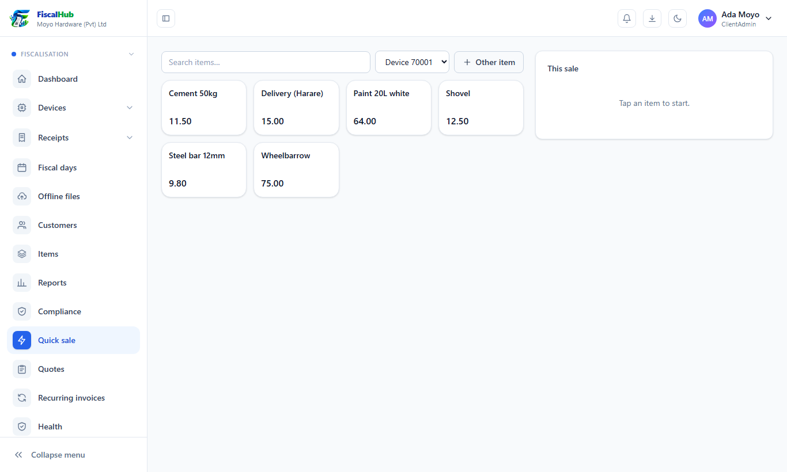
*The Quick sale screen.*

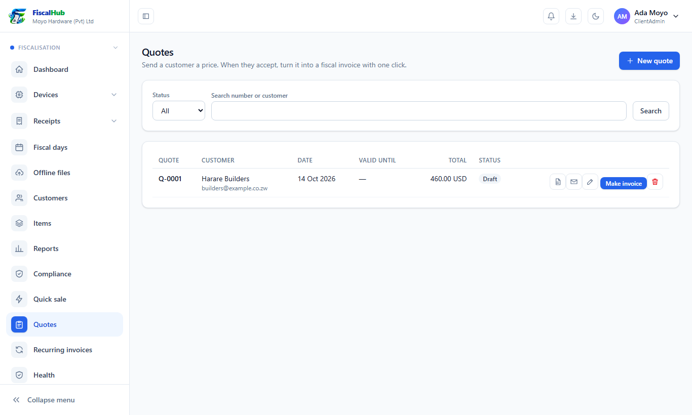
*Quotes.*

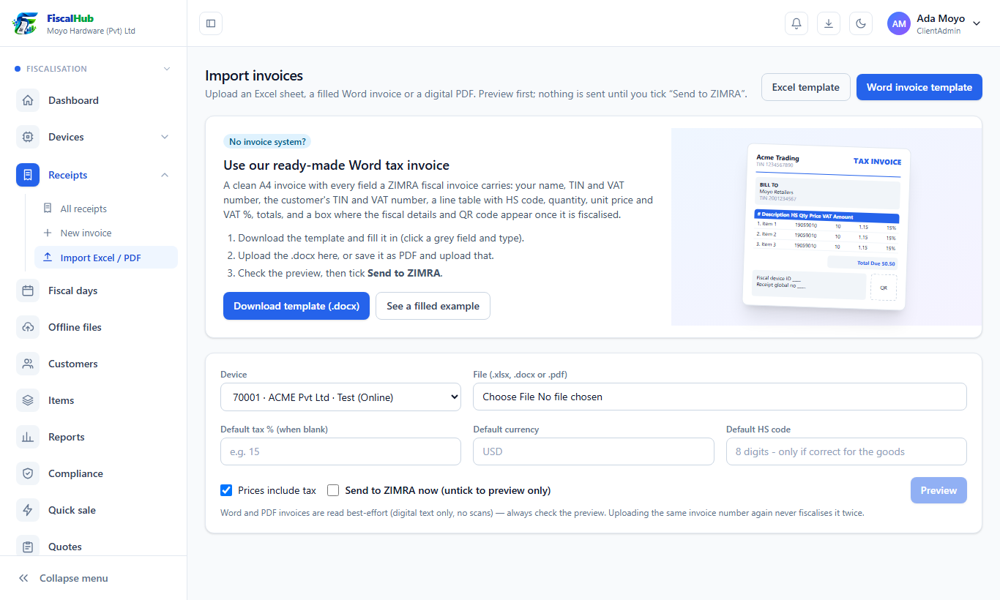
*Importing invoices from Excel or PDF.*

## 10. Reports

**Fiscalisation → Reports** shows, for any period (today, last 7 or 30 days, this or last month, or your own dates) and any device: your **net sales**, the **VAT to account for**, how many invoices and credit notes, **VAT by rate** and **how customers paid**. Credit notes are taken off. Download the **VAT return** (Excel or PDF), a **sales CSV** or a **fiscal days CSV**, or print the page.

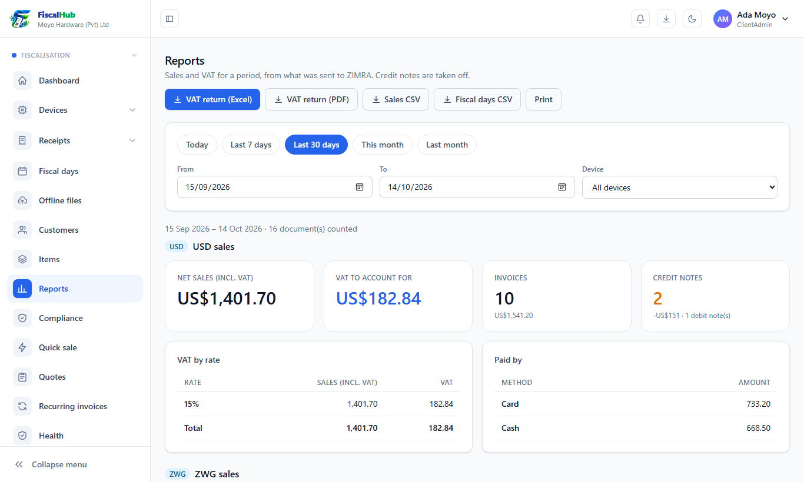
*Sales and VAT reports.*

### Your books: chart of accounts

Every fiscal invoice posts itself to your books. **Accounting → Chart of accounts** shows your accounts as a tree:

- **Sub-accounts.** Click **+** on an account to add one under it (for example *Fuel* and *Vehicle repairs* under *Motor vehicle expenses*). Sub-accounts add up into their parent in every report.
- **Headings.** Tick **Heading** for an account that only groups others. Nothing can be posted to a heading.
- **Appears under.** This is where the account shows in the statements: cash, current assets, property and equipment, current or non-current liabilities, equity, revenue, other income, cost of sales, operating expenses, finance costs or income tax.
- **Codes are suggested.** A new account gets the next free code under its parent, in your format.

**Numbering** sets how your codes look:

- **Format.** For example `9999`, `999999` or `99-9999` (9 = a digit).
- **First digits** for each type (assets 1, liabilities 2 and so on).
- **Gap between suggested codes.**
- **Financial year start.**

Tick **Enforce the format** to refuse codes that don't follow it. **Preview renumbering** shows what every existing code would become; **Renumber** changes them all at once. Entries and reports keep working, because the system finds its accounts by what they are, not by code.

**Import** loads a chart from a CSV file with the columns `code, name, type, sub-type, parent code, heading, description`. Use **Template** for an example. **Export** saves your chart in the same layout.

### Financial reports

**Accounting → Reports** has the trial balance, profit and loss, balance sheet, general ledger and the ageing reports. Each one has quick periods (this month, last month, this quarter, year to date, last financial year), **Print** and **CSV**.

- **Trial balance.** Shows the opening balance, the period's debits and credits, and the closing balance of every account. Sub-accounts sit under their parent; click the arrow to fold them into a subtotal. Income and expenses start each financial year at nil, and earlier years' profit is shown in retained earnings.
- **Drill down.** Click any account name (in the trial balance, profit and loss or balance sheet) to see its postings, with sub-accounts. Click an entry to open the full journal: date, description, where it came from, who posted it and every line.
- **Profit and loss.** Revenue, cost of sales, **gross profit**, operating expenses, other income, **operating profit**, finance costs, **profit before tax**, income tax and **net profit**. Compare with the period before or the same period last year.
- **Balance sheet.** Non-current and current assets, current and non-current liabilities, and equity (with retained earnings and current year earnings). Compare with a year earlier.

### Cashbook: spend money, receive money and transfers

**Accounting → Cashbook** keeps everything that moves money through your cash, bank and wallet accounts.

- **Bank ledger.** Every movement of one account with the running balance. The **other account(s)** column shows what each entry was for. Filter by transaction type: money in, money out, sales, payments, transfers and so on.
- **Spend money.** Record payments that are not supplier bills, such as electricity, rent, fuel, drawings or loan repayments.
  - Choose the account the money left.
  - Choose who was paid.
  - Add one or more lines. Each line has an account, an amount including VAT, a VAT rate and, if you use them, a cost centre. The VAT goes to VAT input by itself.
- **Receive money.** The same for money coming in that is not a fiscal sale, such as capital, a loan, interest or a refund. VAT goes to VAT output.
- **Bank transfers.** Move money between two of your accounts, for example banking the cash takings. You can add a bank charge.

**Save and post** puts it in the books at once. **Save as draft** keeps it for checking: a draft can be changed or deleted. A posted document cannot be edited; **Void** reverses it, and both entries stay in the books.

Every list can be filtered by **transaction date** or **created date**, with quick ranges (today, yesterday, this week, this month) or your own dates, and by status. The total for the period is shown at the top.

**Post to ledger** lists all drafts. Tick the ones that are right (or all of them) and click **Post selected**.

### More from your books

- **Financial dashboard:**
  - revenue, gross and net profit, cash, and what customers and suppliers owe;
  - the key ratios: current and cash ratio, margins, debtor and creditor days, debt to equity, and return on equity;
  - your last twelve months;
  - your biggest expenses.
- **Cash flow statement** (under Financial reports). Shows where cash came from and went: operating, investing and financing. It always agrees with your cash and bank accounts.
- **Cost centres.** Departments, projects or branches.
  - Choose one on journal lines, bills and cashbook lines.
  - A **branch** cost centre receives that branch's fiscal sales by itself.
  - **Profit by cost centre** shows them side by side.
  - Profit and loss and the ledger can also be filtered by one cost centre.
- **Accruals.** When posting a journal, tick **Reverse automatically**. The entry is undone on the date you choose, usually the first day of next month.
- **Recurring journals.** Rent, insurance or loan interest that posts itself every week, month, quarter or year. It can stop on a date and can reverse each time (an accrual). **Post now** posts the next one immediately.
- **Year end.**
  - **Opening balances** lets you enter what each asset, liability and equity account held when you started. The difference goes to *Opening balance equity*.
  - **Close a year** checks that the year has ended, that the trial balance balances, that the bank statements are reconciled and that depreciation has run.
  - Closing locks the year. Its profit stays in retained earnings. An administrator can reopen it.
- **Statements.** On *Customers owing* and *Suppliers*, a statement can be downloaded as a **PDF** (with ageing) or **emailed** straight to the customer or supplier.
- **Export.** Every accounting report and list has **PDF**, **Excel** and **CSV** buttons. Excel files keep the amounts as numbers, ready for formulas.

### Moving your books here: import balances

**Accounting → Import balances** brings in where your business stands on one date (the *conversion date*), from your old system or your accountant. Do one currency at a time.

1. Choose the **conversion date** (usually the end of the month before you start here) and the **currency**.
2. **Trial balance:** download the **Excel template** or upload your own file (Excel or CSV with columns for code, name, debit and credit). **Type them in** lists your chart so you can type the balances instead.
   - Accounts not in your chart are created. Give their name and type; **Shows under** says where they appear in the statements (left alone, they go where the account just before them goes).
   - Income and expense balances are this financial year's figures so far.
3. **Customers who owe you:** each unpaid invoice with what is still owing. Their total must equal accounts receivable in the trial balance. Each one can then be paid and aged under *Customers owing*.
4. **Suppliers you owe:** each unpaid bill, the same way. They appear under *Bills*.
5. **Check everything.** It shows whether the trial balance balances, whether receivables and payables agree with their detail, and what will be created. Fix every red line, then **Post to the books**.

A trial balance that does not balance can still be posted with the difference in *Opening balance equity*, so you can investigate it later. To bring a currency in again, reverse its opening journal under *Journals*.

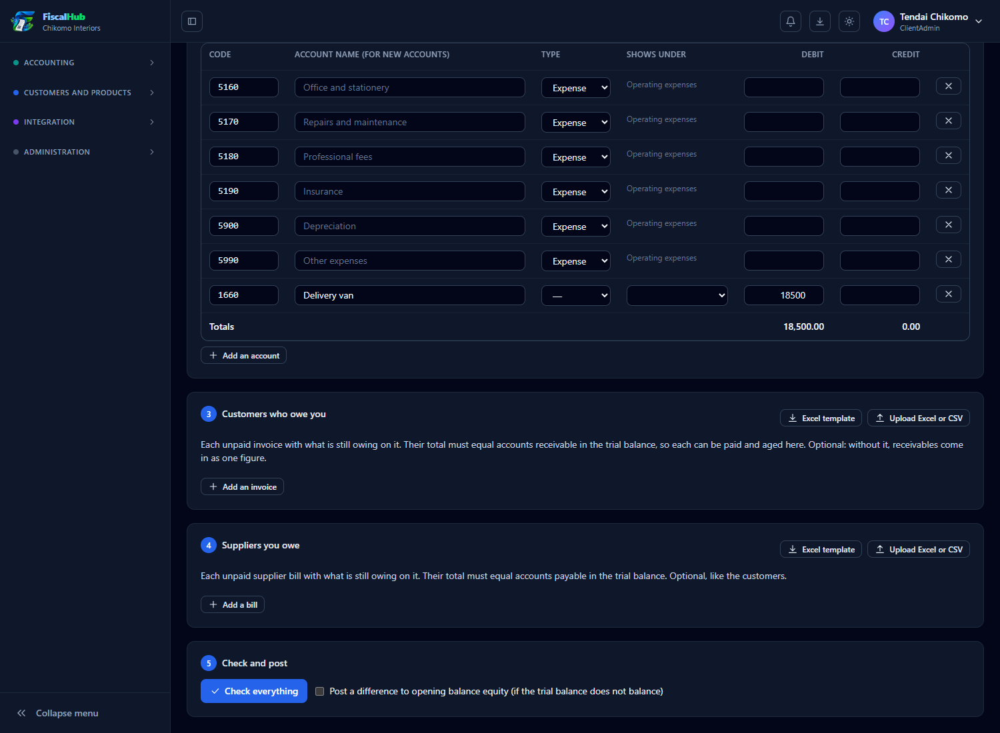
*Typing the balances in: a new account (1660) chooses where it shows.*

### Businesses that do not fiscalise

A business that is not registered for VAT can use FiscalHub for its books alone, on the **Books (accounting only)** plan. Its menu starts with the financial dashboard and has no fiscal devices.

- **Sales invoices:** make a draft, then **Issue** it. Issuing numbers it (INV-000001) and posts it: the customer owes you, against your sales account. Each line can go to a different income account and cost centre, with a discount.
  - The PDF and the email say it is **not a fiscal tax invoice** and carry no VAT.
  - **Receive payment** records money in; **Credit note** reduces an invoice (never by more than is still owing); **Void** takes it back out while nothing has been paid or credited.
  - **Invoice footer** prints your bank details and terms on every invoice.
  - On *Quotes*, **Make invoice** turns a quote into a draft invoice.
- To charge VAT, a business must fiscalise: change to a fiscal plan under *Billing*.

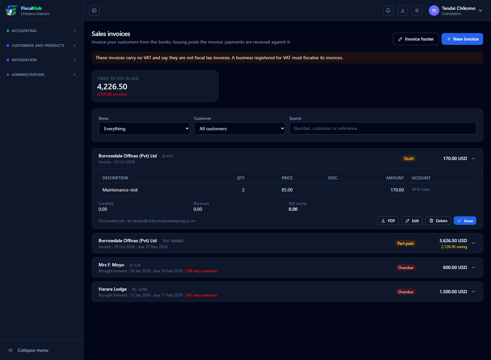
*Sales invoices: a draft, an invoice part paid, and invoices brought forward.*

### Standards for a full set of books

- **Exchange rates.** Set your **base currency** and what each other currency is worth in it from a date. The trial balance, profit and loss and balance sheet then offer **All, in base currency**: assets and liabilities at the rate on the report date, income, expenses and equity at the rate on each transaction's date. The difference shows as the *foreign currency translation reserve*.
- **Prepayments and deferred income.** A year's insurance paid up front, or fees received in advance: record the payment as usual, then add a schedule. Each month that has ended is released by itself to the expense (or income).
- **Statement of changes in equity** (under Financial reports). Opening equity, the profit for the period, capital in and drawings, and closing equity, which agrees with the balance sheet.
- **Financial statements** (under Financial reports). The annual financial statements as one PDF: financial position, profit or loss, changes in equity and cash flows, each with last year alongside, and notes starting with your **accounting policies** (edit the wording on the same page).
- **Audit trail.** Every change to the books, with who made it, when and from where. Posted entries are never edited, only reversed, so the journals and the audit trail together tell the whole story.

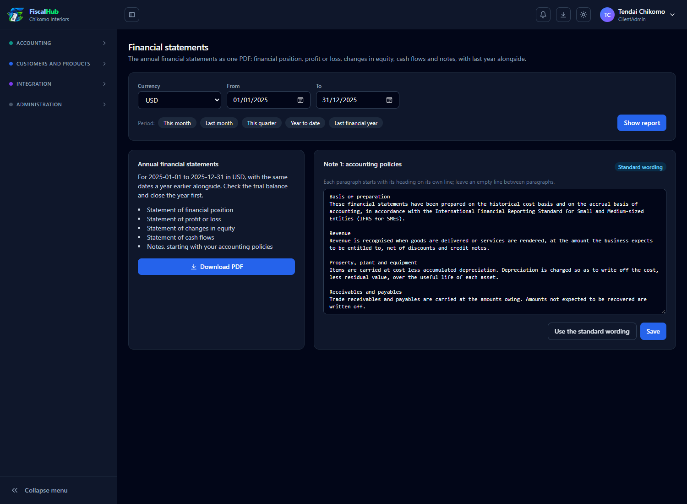
*The annual financial statements and the accounting policies note.*

### Inventory: stock, GRVs, transfers and stock takes

The **Inventory** menu counts your stock, values it at **weighted average cost** and keeps the books up to date by itself.

**Setting up**

1. **Locations:** add each place stock is kept (a warehouse, a shop, a van). Link a location to a **branch** so that branch's till sales take stock from it; the **default** location serves everything else.
2. **Categories:** group items into categories and subcategories (Building → Cement, Paint). A category can keep its items on an inventory or cost of sales account of its own.
3. **Items:** under **Stock items**, tick **Track stock** on what you count. Give it a reorder level to see it on the reorder list when it runs low. The item's name (or code) must match what the till prints, so fiscal sales find it.
4. **Import items** brings your whole item list from Excel or CSV in one go: items, categories, subcategories, prices, reorder levels, and **today's stock per location** (posted as opening stock). Download the **Excel template** to start.

**Every day**

- **Goods received (GRV):** when a supplier delivers, enter the supplier, their invoice number, and each item's quantity and cost before VAT (or upload the lines from Excel). **Post** brings the stock in, recalculates the average cost, and raises the supplier's **bill** under Accounting → Bills (inventory and VAT input against accounts payable). Pay it there as usual.
- **Sales take stock out by themselves.** Every fiscal invoice (and every invoice from the books) that sells a stock item takes it out at average cost and posts the **cost of sales**. A credit note puts it back. This starts on the date of your first GRV or opening stock.
- **Stock transfers:** move stock between locations. Nothing changes in the books.
- **Adjustments:** write off damaged, expired or stolen stock (a minus quantity), or add stock found. The difference goes to *Stock adjustments and write-offs*.
- **Stock takes:** **New stock take**, choose the location, **Every item at this location**, and download the **count sheet** to count on paper or in Excel. Type (or upload) the counts and post: each difference is adjusted and posted.
- A posted document can be **voided**: the stock moves back and the postings are reversed (a GRV also voids its bill, as long as it is unpaid). Every document prints as a **PDF** with signature lines.

**Reports**

- **On hand and valuation:** what you held on any date, by location or category, and whether it **agrees with the inventory accounts** in your books.
- **Stock card:** every movement of one item, with the balance after each.
- **Reorder list:** items at or below their reorder level, with a suggested order and their last supplier.

All of them export to PDF, Excel and CSV.

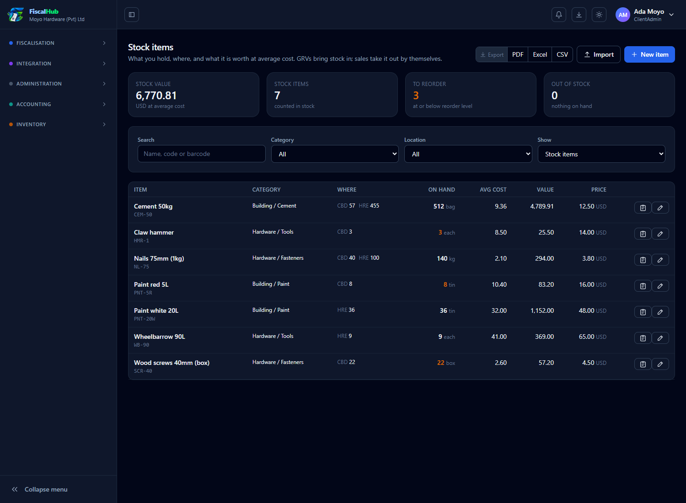
*Stock items: quantities per location, average cost and value.*

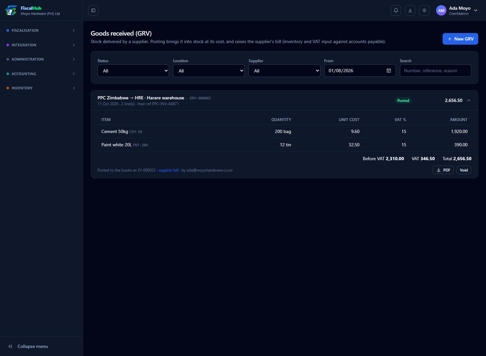
*A posted GRV: it raised the supplier's bill and posted inventory and VAT input.*

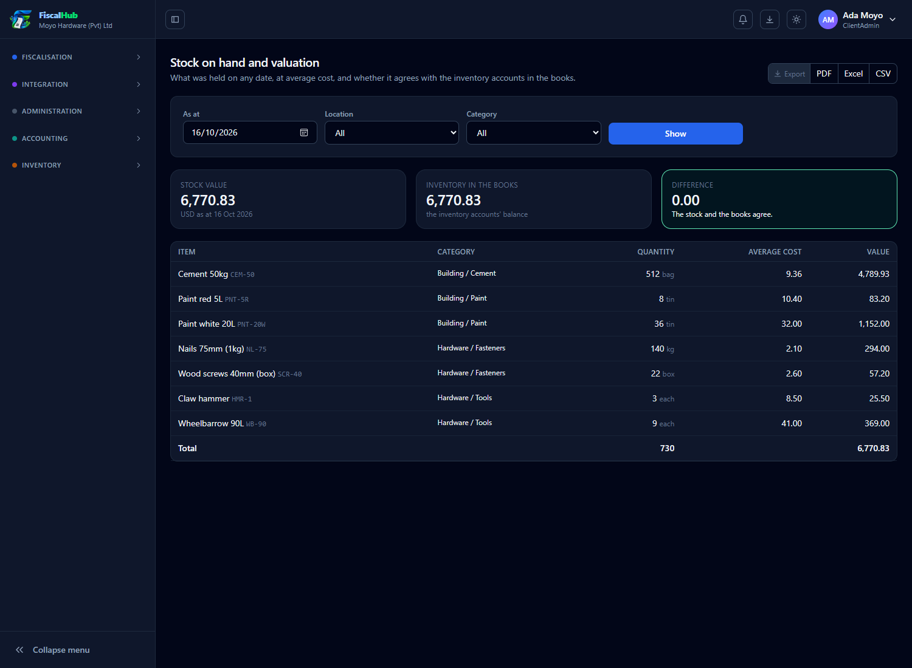
*The stock's value agrees with the books.*

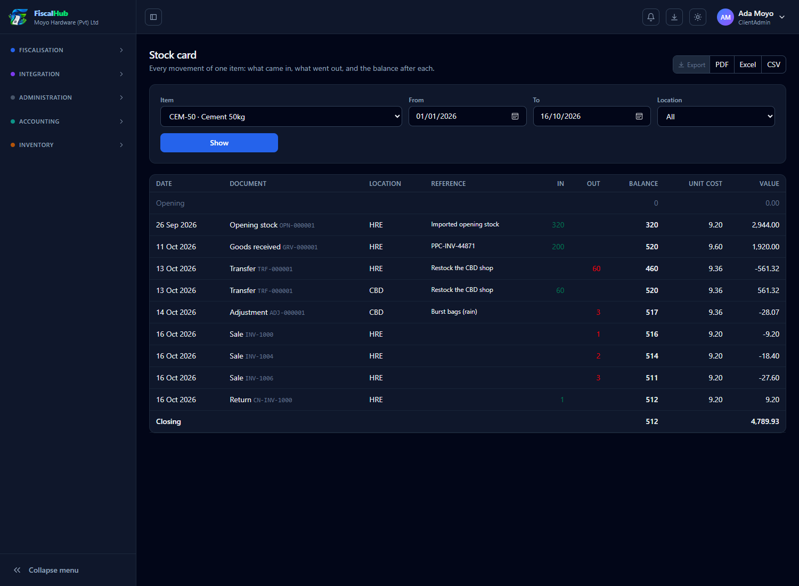
*A stock card: opening stock, a GRV, a transfer, an adjustment, fiscal sales and a return.*

## 11. Users, roles and branches

**Administration → Users:** add your staff and give each a role.

| Role | Can |
|---|---|
| ClientAdmin | Everything for your company |
| Operator | Issue invoices, close the day, manage customers and items |
| Accountant | Accounting, reports, approvals |
| Viewer | Look only |

You can limit a person to some **branches** or devices. **Administration → Branches** lists your shops.

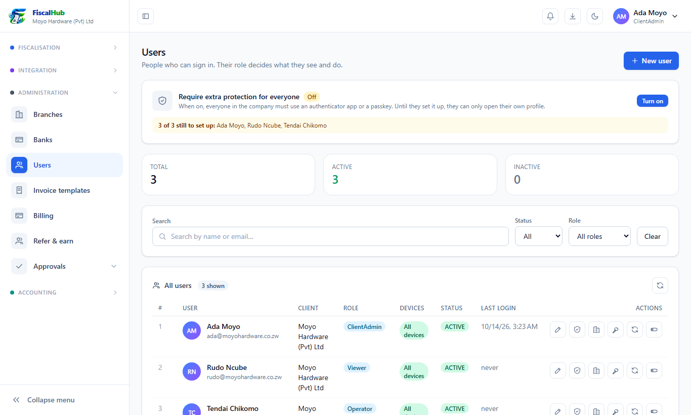
*Your company's users.*

## 12. Your invoice design

**Administration → Invoice templates:** add your logo and colours, choose what the printed invoice shows, or design your own layout with the **invoice builder** (drag text, your logo, the items table and the fiscal box where you want them). The title always reads **FISCAL TAX INVOICE**.

In the builder:

- **Logo:** click **Logo** in *Add to the page*. If the template has no logo yet, choose the picture straight away. Select the logo on the page to **Replace logo** or **Remove logo**.
- **Pictures** (a stamp, a signature, a background design): click **Picture** and **Upload a picture**, or simply **drag a picture file onto the page** and it lands where you drop it.
- PNG, JPEG, WebP and phone photos all work: big pictures are made smaller for you.

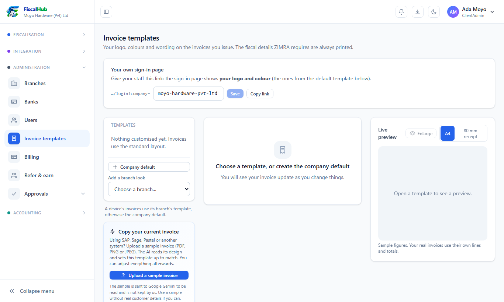
*Invoice templates and the builder.*

## 13. Approvals

Some actions can need a second person's approval: credit notes, bills, journals. Set the rules (from what amount, which role approves) under **Approvals**. Requests waiting for you appear there, on your dashboard and under the bell.

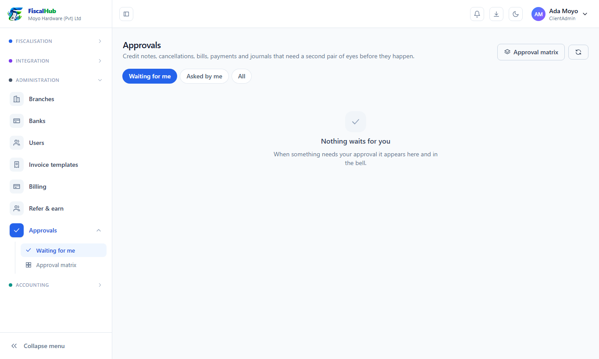
*Requests waiting for approval.*

## 14. Billing, add-ons and going live

**Administration → Billing** shows your **plan**, what you are using, and your invoices.

- **Pay** an invoice by Paynow (card, EcoCash, OneMoney), EcoCash, Stripe or bank transfer. If you paid in cash or by bank and received an **activation code**, type it in.
- **Change plan** to get more devices, users, branches or modules.
- **Add-ons:** add extra devices, users or branches without changing plan. You pay for the rest of the period now, then with each renewal.
- **Live FDMS devices:** every company starts on a ZIMRA **demo** device. To move to live, ZIMRA asks for **six test documents** from your demo device:
  1. a **USD** fiscal invoice, then a **credit note** and a **debit note** against it;
  2. the same three in **ZWG**.

  Issue them under **New invoice**. For the notes, use *Correct…* and *Debit note* on the invoice. Each one is ticked on the Billing page as it is accepted.

  When all six are ticked, click **Send test documents to go live**. We email them to ZIMRA, and the card says **With ZIMRA**.

  When ZIMRA approves, it issues your **live device ID and activation key**. They appear here, after any go-live fee is paid. Click **Register the live device**: the details are filled in, with the environment set to *Production*.

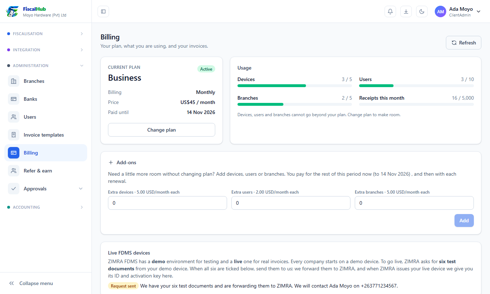
*Your plan, usage, add-ons and going live.*

## 15. Alerts and your profile

The **bell** at the top shows alerts: a certificate about to expire, a day that would not close, a rejected receipt, an invoice to pay. **Notifications** lists them all.

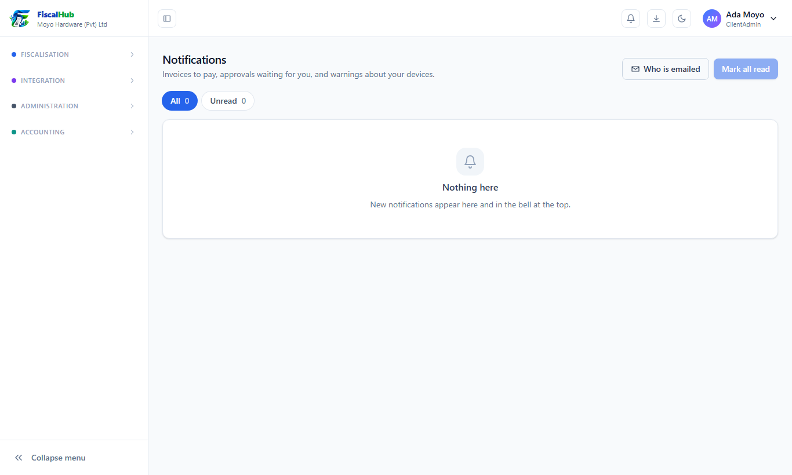
*Your alerts.*

Under your name (top right) → **Profile** you can change your name, phone, password, picture and sign-in security, and:

- **WhatsApp:** link your WhatsApp number to issue invoices and get alerts by chatting (tap **Link WhatsApp** and send the code it shows).
- **SMS alerts:** get your alerts by text message.

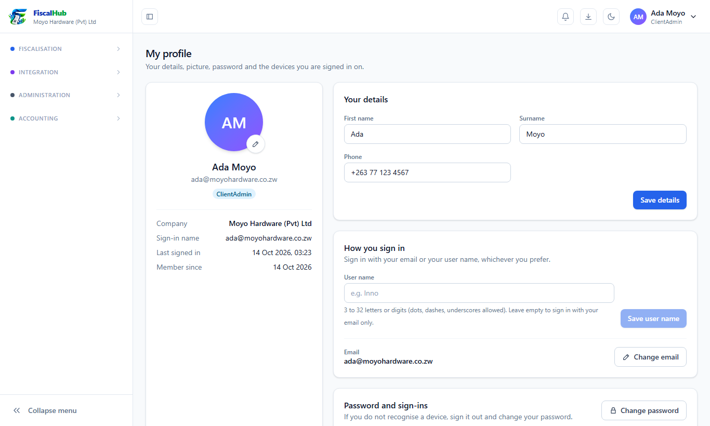
*Your profile, WhatsApp and SMS alerts.*

## 16. WhatsApp and SMS for your company

**Integration → WhatsApp & SMS** (administrators):

- **Your WhatsApp number:** connect your business's own WhatsApp number (Meta WhatsApp Cloud API). Your staff use the FiscalHub assistant on it, your alerts go out from it, and, if you allow it, **your customers** can message it to get copies of their own invoices. The page shows the webhook address and verify token to paste into Meta, and step-by-step help.
- **SMS:** add your own SMS provider (Nhume, Twilio, eSolutions and others) to text invoices and alerts with your sender name. Without one, SMS go through FiscalHub's account (if your plan allows it).

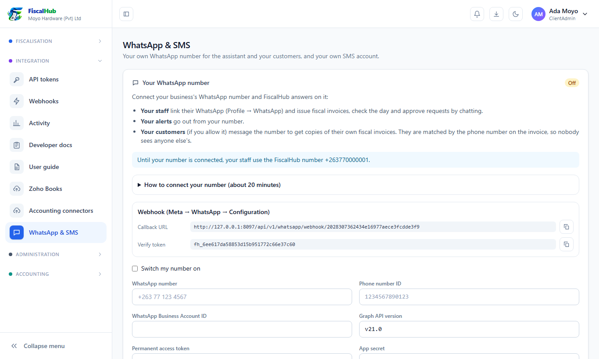
*Your own WhatsApp number and SMS account.*

## 17. Zoho Books

If your books are in Zoho Books, FiscalHub can fiscalise the invoices you raise there.

1. Open **Integration → Zoho Books**, tick what you need, and click **Apply**.
2. When it is approved (and any set-up invoice is paid), connect your Zoho account.
3. Choose your organisation and fiscal device. Every invoice raised in Zoho is then fiscalised, and the fiscal number, verification code and QR appear on the Zoho invoice.

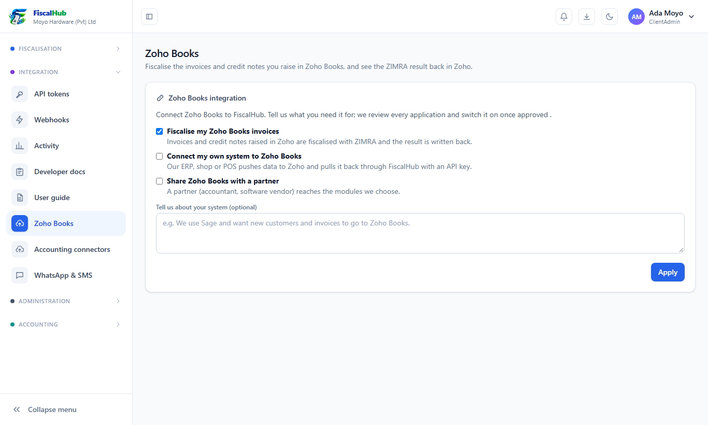
*Applying for the Zoho Books integration.*

### QuickBooks, Xero, Sage and Odoo

Books in **QuickBooks Online**, **Xero**, **Sage Accounting** or **Odoo**? Open **Integration → Accounting connectors** and click your product. Each one is applied for and paid on its own.

1. Click **Apply for …**. When it is approved, any set-up invoice appears under **Billing**; the connector starts working once it is paid.
2. Connect:
   - **QuickBooks, Xero, Sage:** click **Connect**, sign in and allow access.
   - **Odoo:** in Odoo open **My Profile → Account Security → New API Key**, copy the key, and enter your Odoo address (https://…), database, sign-in email and the key.
3. If your sign-in reaches several companies, choose the one to fiscalise.
4. Choose the **fiscal device**, how sales are paid, an HS code for lines without one and the date to start from. Tick **Fiscalise automatically** if you want every new invoice fiscalised within minutes.
5. Invoices and credit notes appear in the list. **Fiscalise** sends one to ZIMRA; the fiscal number, verification code and the fiscal PDF are written back to the document.

| Product | HS code on a line | A credit note points at its invoice by |
|---|---|---|
| QuickBooks | the product's **SKU** | a custom field **Invoice** with the invoice number |
| Xero | the **item code** | allocating it to the invoice |
| Sage | the product's **item code** | the **original invoice number** |
| Odoo | the product's **internal reference** | **Add credit note** on the invoice |

The buyer is named on the fiscal invoice only when their tax number in your books is a 10-digit TIN.

## 18. Connect your own software

If your developers connect your own system (ERP, shop, POS), create an **API token** for each device under **Integration → API tokens**. The token is shown once; give it to your developer together with **Integration → Developer docs**.

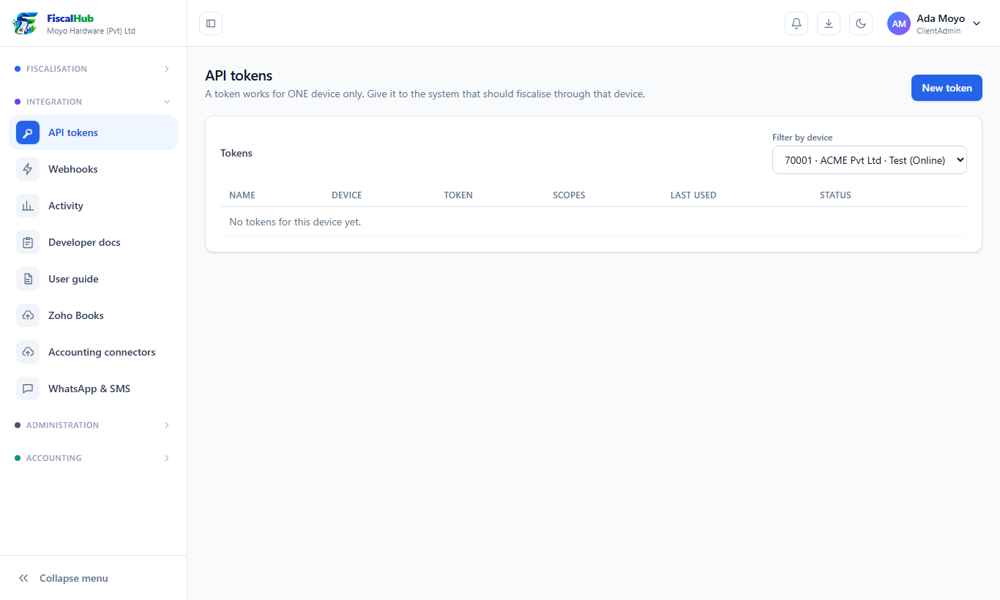
*API tokens.*

## 19. Refer and earn

**Refer & earn** gives you a link to share. When a company you referred signs up and pays, you earn **coins** to spend on free days, extra devices, users or branches, or on your invoices.

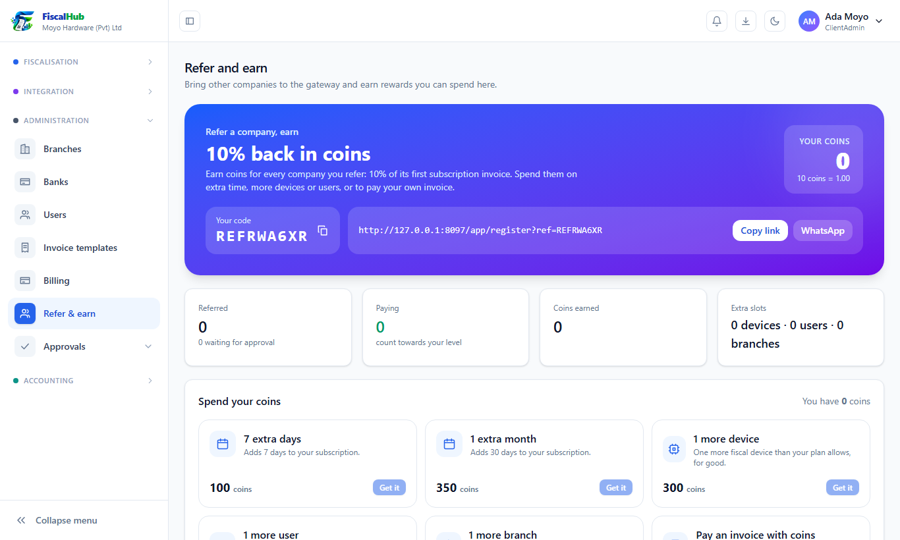
*Your referral link and coins.*

## 20. Help and common questions

| You see | What to do |
|---|---|
| "Check before you send" on a new invoice | Fill in what it lists: invoice number, item names, prices, HS codes. |
| The HS code has the wrong length | Use the 8-digit ZIMRA tariff code. |
| A receipt was **rejected** | Open it with **View**: it says why in plain words. Correct it with **Correct…**. |
| The day would not close | A receipt is flagged red. Correct it, then close the day again. |
| Everything except Billing is locked | Your invoice is unpaid. Pay it under **Billing**; everything opens at once. |
| You cannot add a device, user or branch | Your plan's limit is reached: add an add-on or change plan under **Billing**. |
| A menu is missing | Your role or your plan does not include it. Ask your administrator. |

For anything else, quote what the screen says when you contact support.
