# FiscalHub user guide: for the platform owner

This part is for you, the operator of FiscalHub: you approve companies, set the prices, decide who may use Zoho Books and live devices, and watch the money come in. Sign in with your platform administrator account.

## 1. Your overview

**Administration → Overview** is your morning page:

- **New applications** to review, **payments to confirm**, your **recurring revenue per month** and what was **collected this month**.
- **Platform notifications:** new registrations, Zoho applications, go-live requests, payments. Each has a **Review** button.
- Further down: how many clients, users, devices and receipts the platform has.

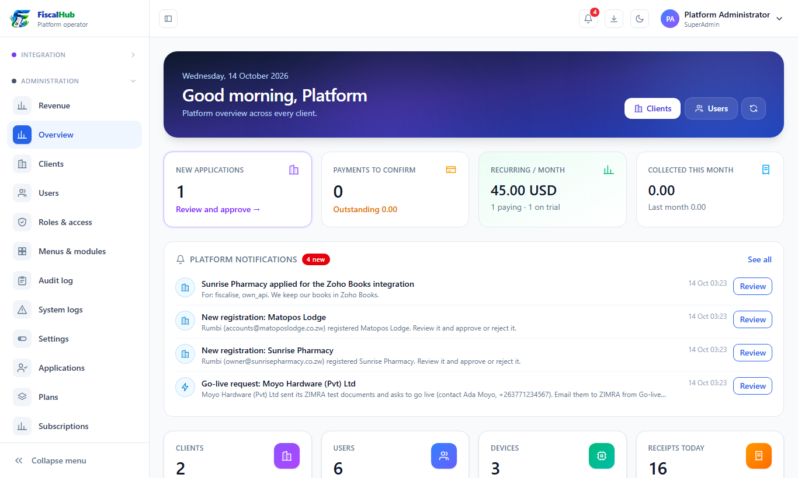
*The overview: what needs you today, and the money.*

The **bell** at the top shows the same notifications; they are also emailed to the alert addresses set under **Settings → Email**.

## 2. Approving new companies

When a company registers, it waits under **Administration → Applications** (unless self-service sign-up is switched on, in which case it opens at once after confirming its email).

1. Open **Applications → Pending**.
2. Click the eye to see the details (company, TIN, contact, plan).
3. Click **Approve** (you can give a free trial) or **Reject** with a reason. The company is emailed either way.

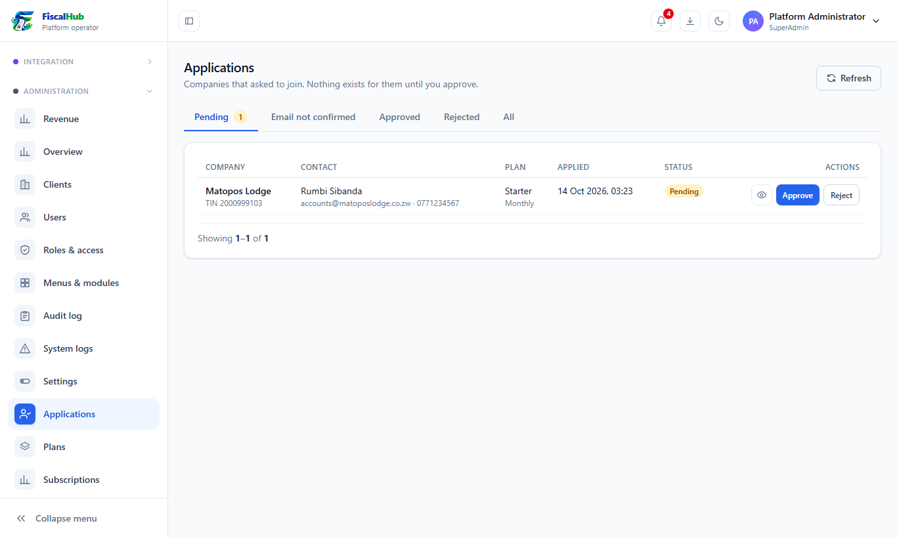
*Companies waiting for approval.*

**Administration → Clients** lists every company: its plan, status, users and devices. From here you can create a company yourself, suspend one, or open its details.

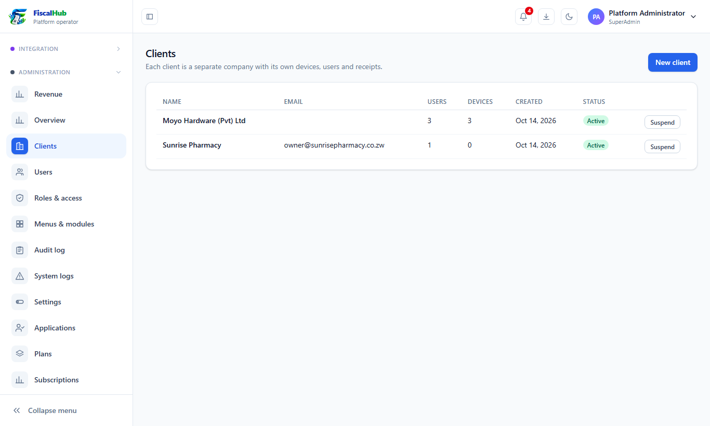
*All companies on the platform.*

## 3. Plans and prices

**Administration → Plans** holds the plans shown on the website and on each company's Billing page. Everything here can change at any time; a change applies from each company's next invoice.

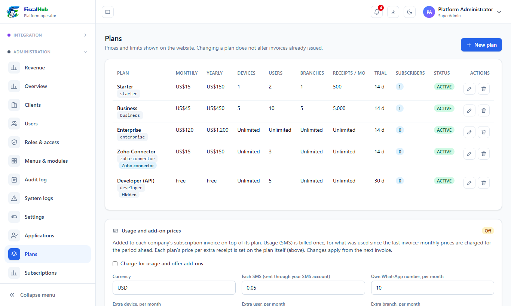
*Your plans, and the usage and add-on prices below them.*

Click **Edit** on a plan to change it:

- **Monthly price**, **yearly price** and **currency**.
- **Limits:** devices, users, branches and receipts per month (0 = unlimited), and the **price per extra receipt** above the allowance.
- **Usage pricing:** a price **per live device** (monthly and yearly), and how receipts are charged:
  - **Included in the plan price (flat)**;
  - **Per 1,000 receipts**, with a **minimum per month** (so small users still pay enough) and a **cap per month**;
  - **Monthly volume bands**, e.g. up to 1,000 receipts = 10, up to 5,000 = 30, more = 60.
- **Modules included:** tick what the plan offers (Accounting, Inventory, Invoice designer, Approvals, Quotes, Quick sale, AI reports, API tokens and webhooks, WhatsApp and SMS, Zoho Books). Companies only see and can use the ticked ones. Fiscalising itself is always included.
- **Free trial** days, the order on the website, and whether the plan is **shown on the website**.

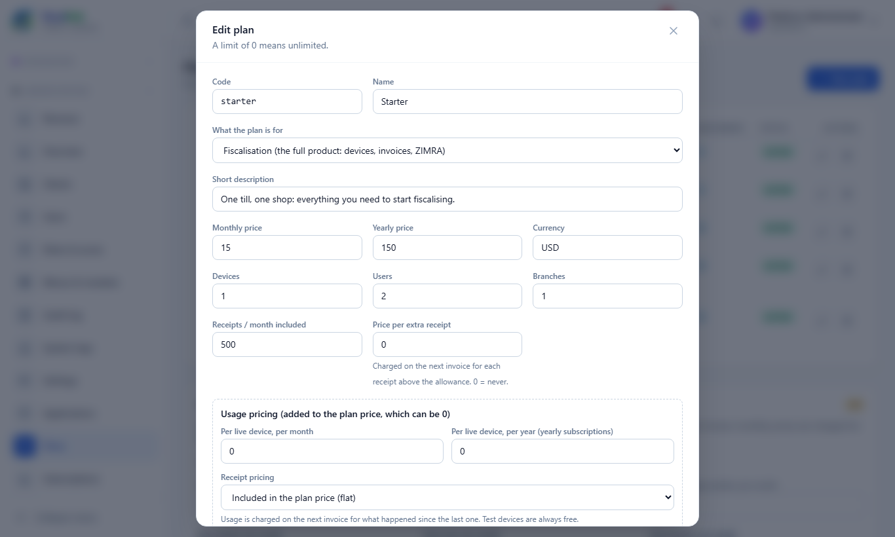
*Editing a plan. The form scrolls.*

Below the plans, **Usage and add-on prices** sets prices that apply to every plan:

| Price | Charged |
|---|---|
| Each SMS sent through your SMS account | Per SMS, on the next invoice |
| A company's own WhatsApp number | Per month |
| Extra device / user / branch (add-ons) | Per month |
| Go-live fee | Once, when you approve a go-live request |
| Each live (Production) device | Per month |

Tick **Charge for usage and offer add-ons** to switch these on. Only companies whose plan is in the same currency are charged.

> A ready-made **Developer (API)** plan exists for software houses: price 0 plus a price per live device and per 1,000 receipts. It is hidden until you tick **Show on the website**.

> A ready-made **Books (accounting only)** plan exists for small businesses that keep their books here without fiscalising. Its kind is *Accounting only*: no fiscal devices, no going live, a menu that starts with the books, and invoices from the books without VAT. Set its price, then tick **Show on the website**. Any plan can be made accounting-only under **Kind**.

## 4. Subscriptions and payments

- **Administration → Subscriptions:** every company's plan, status, when its period ends and what it owes. The two buttons on each row raise an invoice by hand or edit the subscription (plan, status, period). Below, **Unpaid demo accounts** lists trials that will be deleted with their data a week after they end unpaid; click **Keep** to stop that.
- **Administration → Payments:** payments to confirm. When a company pays by bank transfer, EcoCash Send Money or another manual method, it shows here with its reference and proof. **Confirm** it (the invoice is settled and the company opens at once), or send an **activation code** for cash and bank payments, or **Reject** it.

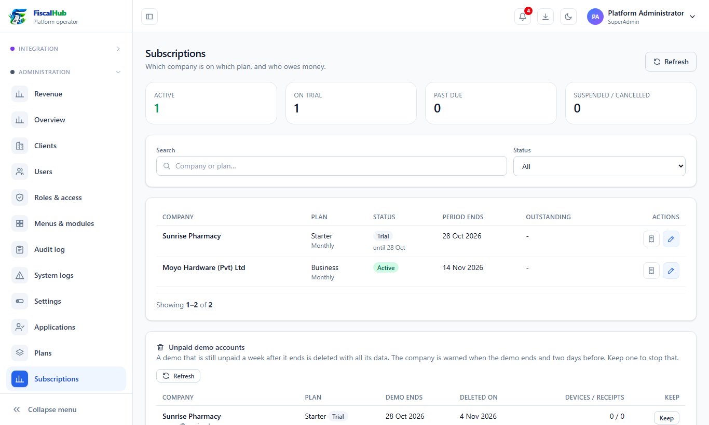
*Subscriptions.*

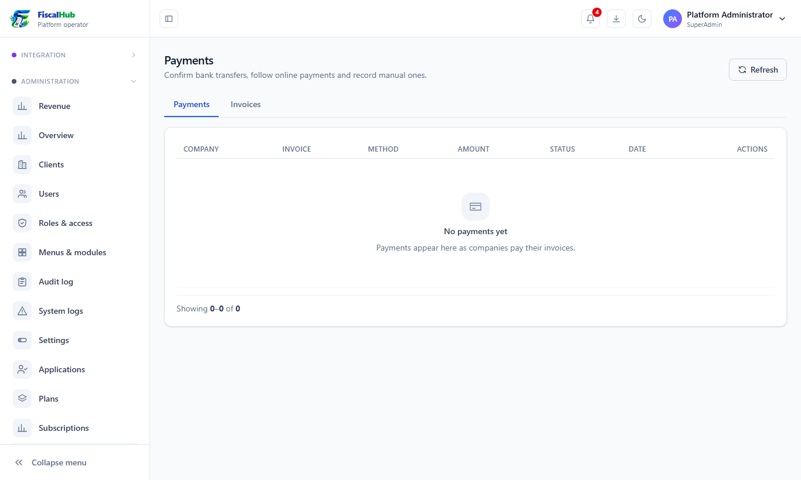
*Payments waiting for confirmation.*

## 5. Going live

Every company starts on a ZIMRA demo (Test) device. ZIMRA moves a taxpayer to live only after seeing **six test documents**: an invoice, a credit note and a debit note in USD, and the same in ZWG. A company can only send its request once all six have been fiscalised on its demo device.

1. Open **Administration → Go-live requests → To send to ZIMRA**. Each request lists the six documents with their numbers, totals, receipt global numbers, fiscal days and devices. **PDF** opens any of them.
2. Click **Email ZIMRA**.
   - The letter is written for you: the company, its TIN and VAT number, the test devices, and the six documents.
   - Enter ZIMRA's address (it is remembered for next time) and, if you like, a copy to yourself.
   - Check the letter and click **Send to ZIMRA**. The six fiscal PDFs are attached.
   - The request moves to **With ZIMRA**, and the company is told.
   - Prefer your own mailbox? **Pack (zip)** downloads the six PDFs and the letter.
3. When ZIMRA approves and sends you the live **device ID and activation key**, click **ZIMRA approved…**.
   - Enter the device ID, the activation key and the serial number if ZIMRA gave one.
   - The **go-live fee** is filled in with your standard fee. Change it, or enter **0** to waive it.
4. With a fee, the request moves to **Awaiting payment** and the company gets an invoice. It goes live the moment the invoice is paid. With 0, it goes live at once.
   - Either way, the company sees the live device and its activation key under Billing, with a button to register it.
5. **Reject** with a reason (for example ZIMRA's answer), or **Cancel** an unpaid approval (its invoice is voided). **Switch live off** takes live access back later.

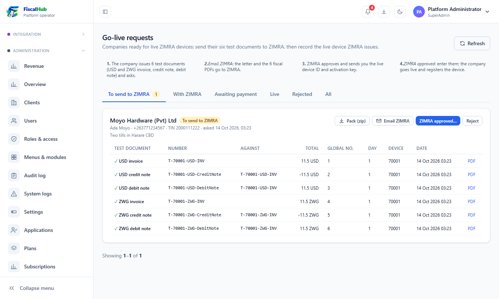
*A go-live request waiting for you.*

## 6. Zoho Books applications

Companies apply to use the Zoho Books integration. **Integration → Integrations monitor**:

- **Applications and access:** **Approve** (with a set-up fee: the company gets an invoice, and the integration switches on when it is paid) or **Reject**. **Suspend** stops a company's Zoho sync, API keys and partner access at once; **Reactivate** undoes it.
- **Connections:** each company's Zoho connection, whether its sign-in is alive, when it last synced, and what failed.
- **Live API keys:** every key that can reach Zoho Books through FiscalHub; **Revoke** stops one at once.
- **What a connection costs:** your Zoho prices (set-up fee, monthly fee, documents included, price per extra document, bridge fee).

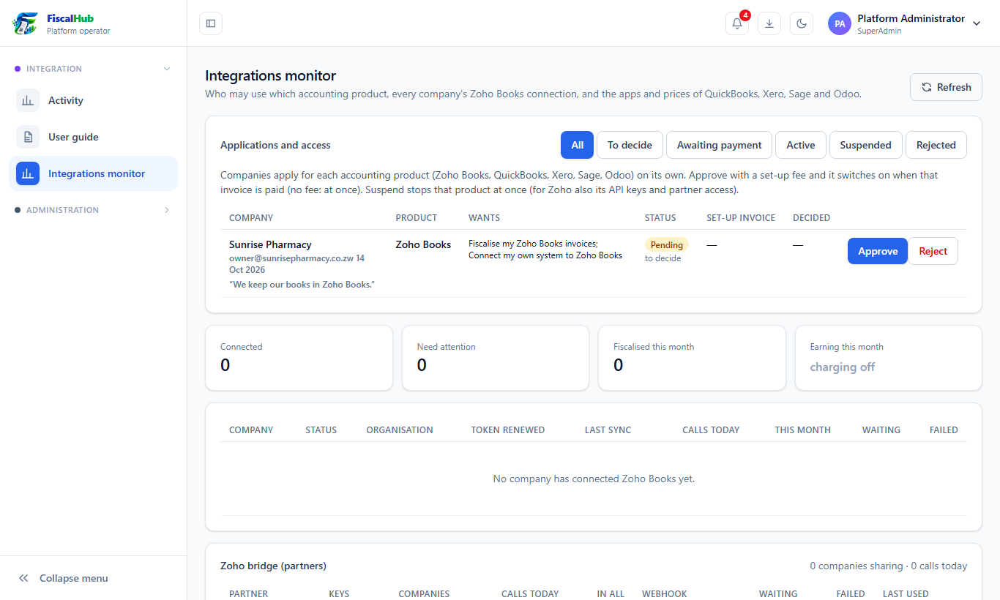
*Zoho applications, connections and keys.*

### QuickBooks, Xero, Sage and Odoo

These are separate products, applied for and approved in the same **Applications and access** list (the **Product** column says which). Suspending one leaves the others running.

At the bottom of the monitor, **QuickBooks, Xero, Sage and Odoo** has a tab per product:

- **App:** QuickBooks, Xero and Sage need an app registered with the provider. Copy the **redirect address** shown into the provider's developer portal, then paste the **client ID** and **secret** back. Tick **Sandbox** for QuickBooks test companies. Odoo needs no app.
- **Prices:** set-up fee, monthly fee, documents included and price per extra document. They are added to the company's subscription invoice, separately from Zoho's.

## 7. Revenue

**Administration → Revenue** shows what the platform earns:

- your **recurring revenue** per month and per year, from how many paying companies;
- what was **collected this month** and in the **last 12 months**, the **outstanding** and **overdue** invoices, and the **average per paying company**;
- how many companies are **paying**, **on trial**, have **trials ending** in 7 days, are **past due** or **suspended**, are **new this month**, and how many **payments wait for you to confirm**;
- a chart of what was **collected per month**, and **how companies pay**.

Collected money counts every paid invoice: subscriptions, set-up and go-live fees, add-ons and usage.

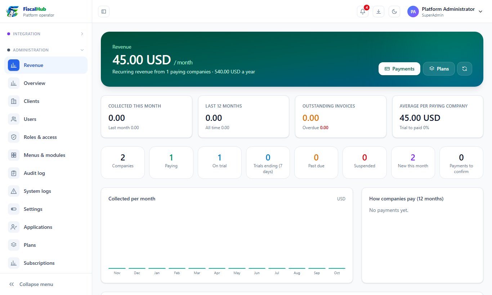
*Your revenue.*

### Your own books (Accounting)

The **Accounting** menu holds the platform's own books: the same journals, ledger, trial balance, profit and loss, balance sheet and cash flow your companies use, but for your business. They are separate from every company's books; no company can see them.

Billing posts into them by itself:

| When | Posting |
|---|---|
| You issue an invoice to a company | Company owes you (accounts receivable) / income, by kind: subscriptions, integration fees, go-live and set-up fees, add-ons, other / VAT |
| The invoice is paid | Money in (cash, bank, mobile money or card, from the payment method) / accounts receivable |
| A partner's company pays | Partner commissions (a cost of sales) / commissions payable to partners |
| You pay a partner out | Commissions payable / bank |
| An unpaid invoice is voided | The invoice posting is reversed |

Each billing record is posted once, however often the books are opened. **Journals → Post new billing** posts anything new straight away.

Record your own costs (hosting, salaries, SMS bundles, rent) with **Cashbook → Spend money**, money in from elsewhere with **Receive money**, and anything else with a manual journal. Your company name and tax number on the reports come from **Settings → Billing profile**.

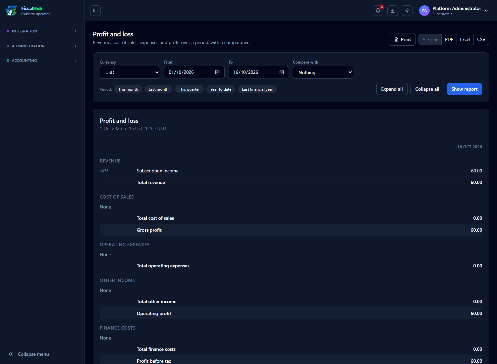
*The platform's profit and loss: subscription income from billing.*

## 8. Settings

**Administration → Settings** holds everything platform-wide:

- **Public API address** and **web app address**, used in emails, payment returns and the developer documentation.
- **Email:** the mail server for invoices, alerts and password resets, and the **alert addresses** that get your platform notifications.
- **Mobile app download links** (APKPure, Google Play, App Store) shown on the website.
- **WhatsApp assistant:** your FiscalHub WhatsApp number (Meta Cloud API), for companies without their own.
- **SMS (platform account):** your SMS provider for sign-up codes, password codes, your own alerts and (if you allow it) companies without their own SMS account.
- **Payment gateways:** Paynow, EcoCash, Stripe and manual methods, and your **bank details**.
- **Billing profile:** your company name, logo, VAT rate and invoice wording on the invoices you send to companies.

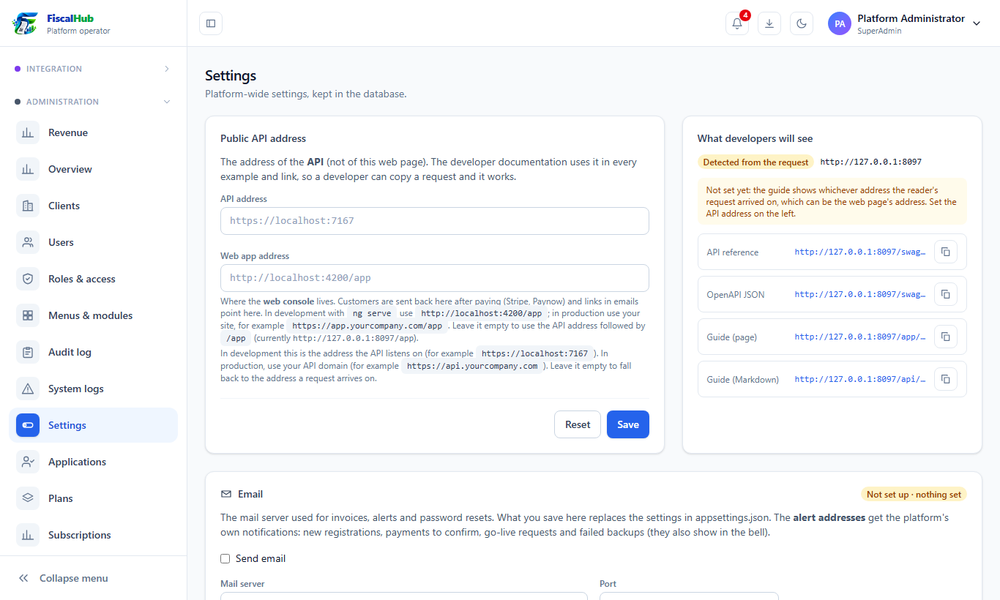
*Platform settings (the page continues below).*

## 9. Partners

Partners (accountants, software vendors) bring you companies and earn commission on what those companies pay.

1. **Administration → Partners → New partner:** name, contact, and the **kind of partner**:
   - **Commission:** it earns a **commission %** of what its companies pay you.
   - **Reseller:** its companies pay your plan prices **less the reseller discount %** (they see it on their Billing page). The reseller charges them for its own services and earns no commission from you.

   FiscalHub gives the partner a **code**.
2. On the partner's card, **Staff** adds the people who sign in to the partner portal.
3. The partner shares its referral link; companies that register with it become the partner's. **Link a company** attaches an existing company to a partner by hand.
4. **Statement** shows what the partner earned and was paid; **Pay out** records a payment to the partner, who then sees what is still owed.

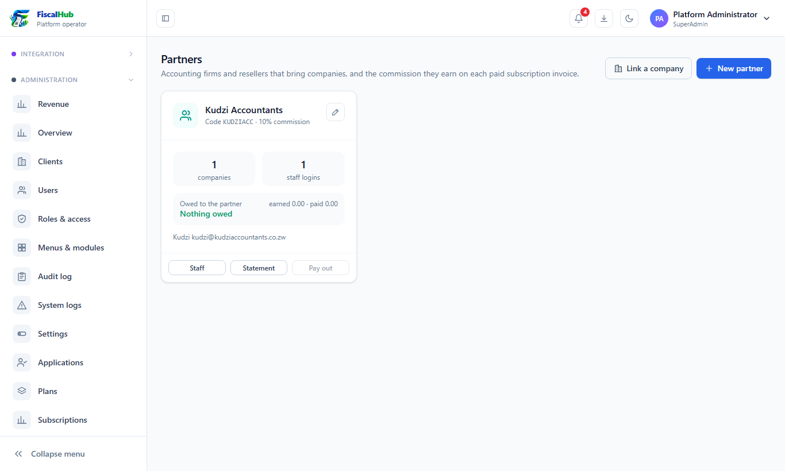
*Your partners and their commission.*

## 10. Roles, menus and security

- **Roles & access:** what each role may do (permissions) and which menus it sees.
- **Menus & modules:** the sections and pages of the menu.
- **Audit log:** who did what, when, from where. **System logs:** errors and warnings.
- **Backups:** the database backups and their checks.

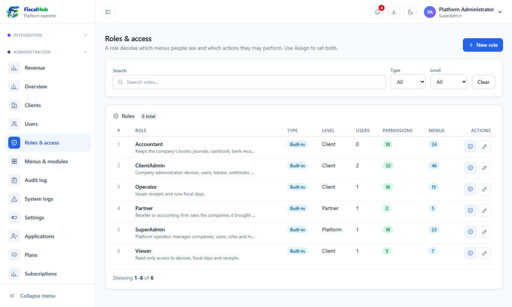
*Roles and what they may do.*

## 11. Your daily checklist

1. **Overview:** read the notifications; approve or reject new applications.
2. **Payments:** confirm bank and manual payments so companies are not kept waiting.
3. **Go-live requests** and **Zoho applications:** decide.
4. **Integrations monitor:** look for connections that need attention.
5. Once a month: **Revenue**, and your **Plans** prices.
