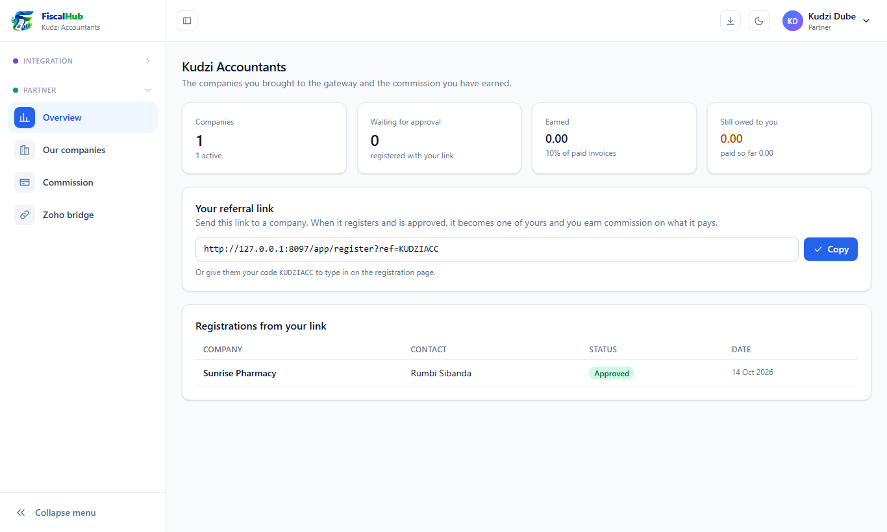
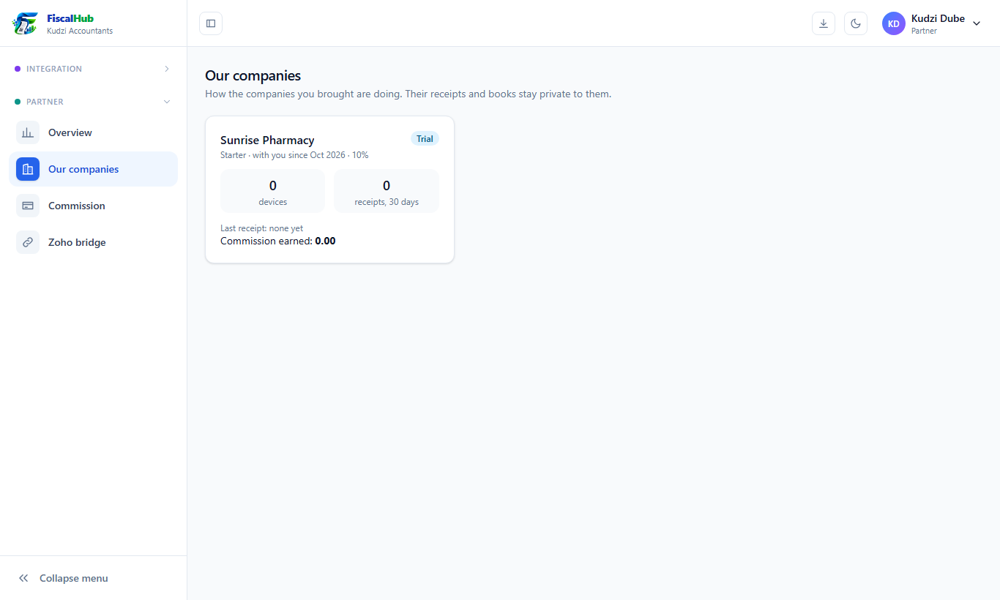
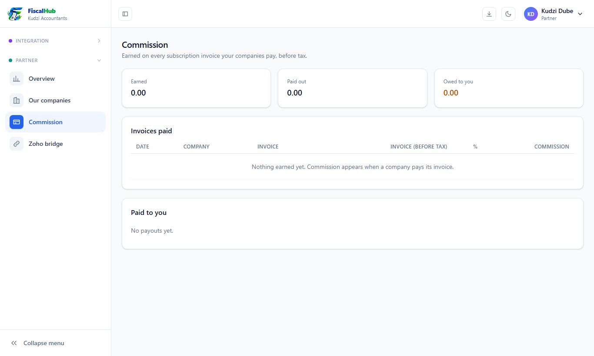
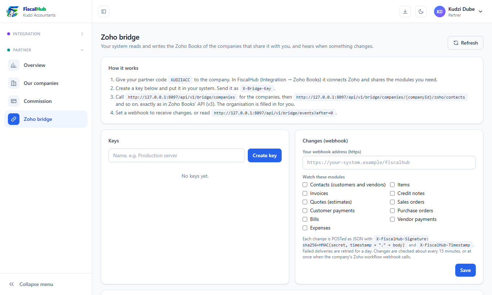

# FiscalHub user guide: for partners

As a FiscalHub partner (an accountant, a software vendor or a consultant) you bring companies to FiscalHub. A **commission partner** earns a share of what its companies pay; a **reseller** gets its companies a lower price (its discount) and charges them for its own services. If you build software, the **Zoho bridge** also lets your system work with the Zoho Books of the companies you serve. Sign in with the account the platform owner created for you.

## 1. Your overview

The **Overview** shows:

- how many **companies** you brought, and how many are still **waiting for approval**;
- what you have **earned** (your commission % of their paid invoices) and what is **still owed to you**;
- **your referral link** and **code**;
- the **registrations from your link** and their status.

*Your companies, commission and referral link.*

## 2. Bring a company

1. Click **Copy** next to your referral link and send it to the company (email, WhatsApp).
2. The company registers through the link, or types your code on the registration page.
3. When the platform owner approves it, it becomes one of your companies and you start earning on what it pays.

## 3. Your companies

**Our companies** shows each company you brought: its plan, since when it is with you, your commission rate, its devices, its receipts in the last 30 days and the commission it has earned you. Their receipts and books stay private to them.

*The companies you brought.*

## 4. Commission

**Commission** is your statement: every commission line from your companies' paid invoices, the payouts the platform owner has made to you, and the balance still owed.

*Your commission statement.*

## 5. Zoho bridge (for software partners)

With the Zoho bridge, **your** system can read and write the Zoho Books data of the companies you work for, through FiscalHub, without handling Zoho sign-ins or tokens.

1. Each company enters **your partner code** under its **Zoho Books → Partner access**, and chooses which modules you may use and whether you may write.
2. Under **Zoho bridge**, create an **API key** (it starts with `fhb_` and is shown once) and, if you want to be told about changes, set a **webhook** address.
3. Your developers call FiscalHub with the key. The **Developer docs** (*Zoho bridge for partners*) describe every call and field.

*Your bridge keys, webhook and the companies that shared with you.*

## 6. Common questions

| Question | Answer |
|---|---|
| A company registered but is not in my list | It is waiting for the platform owner's approval, or it registered without your link or code. |
| When is commission earned? | When the company's invoice is paid. |
| A company is not "ready" on the bridge | It must connect Zoho Books, and its Zoho integration must be switched on. |
